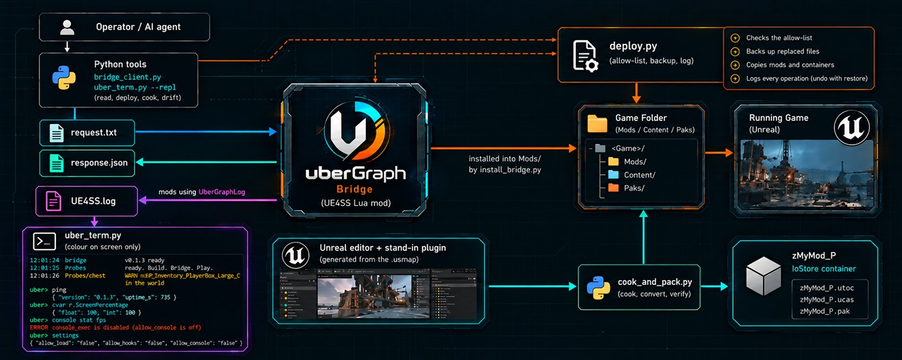

<p align="center">
  
</p>

# uberGraph

**Build. Bridge. Play.**

An evidence-driven modding toolkit and AI bridge for Unreal Engine games. It lets a person, or an AI agent working for them, look inside a
running game, form a hypothesis, test it with the smallest possible change, and ship a reversible mod, while keeping every claim tied to
evidence.

> **Status: alpha (0.1.0).** The core loop is proven on one game; it is not a finished product. Read [Maturity](#maturity) and the
> [FAQ](#faq) before relying on it.

## Contents

[What it is](#what-it-is) · [What it does](#what-it-does) · [How it fits together](#how-it-fits-together) · [Requirements](#requirements) ·
[Configuration](#configuration) · [Usage](#usage) · [Safety model](#safety-model) · [Repository layout](#repository-layout) ·
[Tests and release flow](#tests-and-release-flow) · [FAQ](#faq) · [Maturity](#maturity) · [Games](#games) · [Licence and credits](#licence-and-credits)

## What it is

Modding a shipped Unreal game means working blind: no SDK, no source, native classes you cannot inspect, assets in containers you cannot
edit. uberGraph closes that gap with three ideas:

1. **A bridge into the running game.** A UE4SS Lua mod answers requests written to a folder, so a script (or an AI agent) can ask the game
   what a class looks like, what an object holds, or what a console variable is set to, without writing a new mod for every question.
2. **Authoring against stand-ins.** The game's native module is reconstructed as a small plugin from its `.usmap` mapping (names, types and
   order only), so you can build items, skills and Blueprints in the matching Unreal editor, cook them to an IoStore container, and have the
   game load them.
3. **An evidence trail and a safety model.** Every change goes through a profile, an allow-list, a backup and a log; every risky capability is
   off by default and turned on only with the operator's own words.

It is a toolkit, not a mod: nothing here is specific to one game, and the research and mods for each game live in that game's own repository
(see [Games](#games)).

## What it does

**Read the running game** (the [`[uberGraph] Bridge`](bridge/README.md))
- `ping`, `status`, `find_all`, `get`, `describe_class`, `get_array`, `read`, `find_object`, `scan`, `map_info`, `probe_methods`, `map_peek`,
  `describe_function`: classes, objects, properties, arrays, maps (shape only), function signatures. Read-only.
- `cvar_get`: console variable readings (float, int, bool) through the engine's own getters.
- Behind off-by-default options: `load_asset` (`allow_load`), `watch_function` (`allow_hooks`, an observe-only hook that records strings) and
  `console_exec` (`allow_console`, one allow-listed console command at a time).

**Watch and talk to it** ([`tools/term`](tools/term))
- `uber_term.py` follows `UE4SS.log`, classifies every line (component, level) and colours it on your screen while the log file stays plain
  text. Filters: `--only`, `--level`, `--grep`, `--once`, `--from-start`.
- `uber_term.py --repl` adds an `uber>` prompt: `ping`, `cvar NAME`, `console COMMAND`, any bridge operation, `settings` (read-only).
- `UberGraphLog` ([`lua/shared`](lua/shared)): the Lua logger for mods (prefix, plain-text level, control characters removed).

**Manage the game and the profile** ([`tools/profile`](tools/profile), [`tools/deploy`](tools/deploy), [`tools/drift`](tools/drift))
- A per-game profile (paths, build id, hashes, allowed write paths, launch options) that every tool reads instead of hard-coded paths.
- `deploy.py`: copies files into the game folder only inside `deploy.allowedPaths`, with backup, hash check, log, undo (`restore`) and an
  optional drift check. Dry run by default.
- `check_drift.py`: has the game changed (Steam build id, executable hash, container sizes, mapping hash) since the profile was recorded?

**Build mods** ([`tools/usmap`](tools/usmap), [`tools/ue-editor`](tools/ue-editor), [`tools/cook`](tools/cook), [`unreal/example`](unreal/example))
- `gen_stubs.py`: generates the editor-side stand-in plugin for chosen game classes from the `.usmap`; `compare_layout.py` and `dump_layouts.py`
  check the layout against the real one.
- `ue_remote.py` and the examples: drive the Unreal editor (MCP and Python remote) to create assets without clicking.
- `cook_and_pack.py`: cook, convert with `retoc`, verify, scan for forbidden references, optionally deploy: one command per container.
- `bpdump`: read Blueprint functions and Kismet bytecode from a read-only extraction.

**Keep it honest** ([`tools/lua-check`](tools/lua-check), [`tools/test_all.py`](tools/test_all.py), [`tools/check-repo-hygiene.sh`](tools/check-repo-hygiene.sh))
- Lua syntax check and behaviour tests for the bridge and the logger, run in a Lua VM with a fake UE4SS API: no game needed.
- One gate command, `python tools/test_all.py`, and a hygiene scan that refuses game assets, mappings, secrets, oversized files and caches.

## How it fits together

<p align="center">
  
</p>

*The flow of the toolkit. The terminal panel shows example output of the real commands (see [Usage](#usage)). The same flow in text:*

<details>
<summary>The same flow as a text diagram</summary>

```
 operator / AI agent
        |
        |  bridge_client.py, uber_term.py --repl           python tools (read, deploy, cook, drift)
        v                                                          |
 request.txt  ------------------------------>  [uberGraph] Bridge  |  deploy.py (allow-list, backup, log)
 response.json <------------------------------  (UE4SS Lua mod)    v
        ^                                              |      game folder (Mods/, Content/Paks)
        |                                              v
 UE4SS.log  <----------  mods using UberGraphLog   running game (Unreal)
        |
        v
 uber_term.py (colour on screen only)

 Unreal editor + stand-in plugin (from .usmap)  --cook_and_pack.py-->  zMyMod_P IoStore container  -->  game
```

</details>

The bridge protocol is plain `key=value` request files and JSON responses in the mod's `io/` folder; no code is ever executed from a request.

## Requirements

| For | You need |
|---|---|
| Reading a running game | Windows, the game with [UE4SS](https://github.com/UE4SS-RE/RE-UE4SS) (tested with 3.0.1), Python 3.10+ (tested with 3.14). |
| Lua tests | Node.js; `cd tools/lua-check && npm install` (luaparse for syntax, fengari to run the tests in a Lua VM). |
| Authoring and cooking | The Unreal editor of the **same engine version** as the game, its C++ toolchain (MSVC), [`retoc`](https://github.com/trumank/retoc), and the game's `.usmap` mapping (kept local, never committed). |
| Blueprint bytecode | .NET SDK and a read-only extraction of the game's containers. |

## Configuration

**1. The game profile** tells every tool where the game is and what it may write. Copy the example and fill in real paths; the copy is local
(`profiles/*.local.json` is git-ignored):

```bash
cp profiles/the-last-caretaker.example.json profiles/my-game.local.json
python tools/profile/game_profile.py my-game             # prints it; placeholders such as <...> are reported as missing
```

| Field | What it is for |
|---|---|
| `ue4ss.dir` | The `ue4ss` folder next to the game's shipping executable; the bridge, terminal and deploy find `Mods/` and `UE4SS.log` from it. |
| `game` | Install root, executable, Steam app id, build id: what the drift check compares. |
| `mappings` | Path and hash of the `.usmap` (stand-in generation, asset parsing). |
| `engine`, `editorProject` | Engine version, editor build and root, the `retoc` version to convert with, and the authoring project (cook, editor automation). |
| `cook` | Path of the `retoc` executable and the output folder of cooked files. |
| `launch` | Launch options and known issues (notes). |
| `deploy.allowedPaths` | The **only** places the tools may write, for example `<ue4ss>/Mods/[uberGraph] */`, `<ue4ss>/Mods/shared/UberGraphLog/` and `<game>/Content/Paks/z*_P.*`. A pattern ending in `/` allows a folder; `*` does not cross `/`. |
| `deploy.backupDir` | Where replaced files and the operation log go. |

Field-by-field notes: [`docs/GAME-PROFILES.md`](docs/GAME-PROFILES.md). Record a baseline with `python tools/drift/check_drift.py my-game --record`.

**2. Install the bridge and the Lua libraries** (dry run first):

```bash
python tools/bridge/install_bridge.py install            # prints what would be copied
python tools/bridge/install_bridge.py install --apply    # backup + hash check + log; restart the game afterwards
python tools/bridge/bridge_settings.py init              # writes settings.txt with every risky option off
```

**3. Settings** live in `Mods/[uberGraph] Bridge/settings.txt`, are read on every use (no restart) and a missing key means OFF:

| Setting | Turns on | Consequences (short) |
|---|---|---|
| `allow_load` | `load_asset` | The game thread can pause while an asset loads; memory goes up; a strange asset can crash the game. |
| `allow_hooks` | `watch_function` | A hook runs every time the function runs (cost on hot functions); hooks were a crash suspect elsewhere. Records strings only. |
| `allow_console` | `console_exec` | Changes the running game (variables, overlays, log categories) until restart or until set back; a bad value can make it slow or unstable. Only allow-listed commands run. |

An agent must ask the operator and explain the consequences first; the settings tool refuses to turn an option on without the operator's own words
(`--user-approved "..."`) and logs them. Full text next to each option in `settings.example.txt` and in [`bridge/README.md`](bridge/README.md).

**4. Probe key binds** (for the single Lua probe an agent may keep per game): ask the operator's keyboard type (an 80% keyboard has no numpad),
avoid the game's keys, window-control keys (F11, Alt+Enter) and keys reserved by the game client (Steam: F12, Shift+Tab), and ask once about overlays.

## Usage

```bash
python tools/bridge/bridge_client.py health                    # heartbeat age, nothing sent
python tools/bridge/bridge_client.py ping                      # version, uptime
python tools/bridge/bridge_client.py find_all PlayerController
python tools/bridge/bridge_client.py describe_class object:pawn 50
python tools/bridge/bridge_client.py cvar_get r.ScreenPercentage
python tools/term/uber_term.py --repl                          # coloured log plus the uber> prompt
python tools/deploy/deploy.py copy mods/MyMod --to "<ue4ss>/Mods" --check-drift --apply    # drop --apply for a dry run
python tools/cook/cook_and_pack.py --container zMyMod_P --package /Game/MyMod/Thing --filter Thing
```

Step-by-step, including a first mod: [`docs/QUICKSTART.md`](docs/QUICKSTART.md). Pipeline and pitfalls of cooked assets:
[`docs/COOKED-ASSET-PIPELINE.md`](docs/COOKED-ASSET-PIPELINE.md), [`docs/UE-EDITOR-AUTOMATION.md`](docs/UE-EDITOR-AUTOMATION.md), [`docs/UE4SS-LUA-NOTES.md`](docs/UE4SS-LUA-NOTES.md).

## Safety model

- The original game installation is never modified. Installs go through `tools/deploy`: allow-list, backup, hash check, log, undo.
- Every operation that changes the running game (`load_asset`, `watch_function`, `console_exec`) is **off by default** and is enabled only by the operator, never for one experiment.
- Mutating experiments need the operator's explicit approval; an agent does not commit or promote on its own initiative.
- Game assets, extracted content, mapping files, local profiles and secrets are never committed (`.gitignore`, `tools/check-repo-hygiene.sh`). `.gitignore.example` is for people who want to version their own mods and analysis inside their copy.
- At most one Lua probe mod per game is created by an AI agent; logs are plain text with a component prefix (colour belongs to the viewer).
- Native crashes cannot be caught from Lua. The bridge is local-only and has no authentication: do not expose its `io/` folder.

## Repository layout

```
bridge/uber-bridge/    the [uberGraph] Bridge (installed as Mods/[uberGraph] Bridge)
bridge/                bridge documentation: operations, risky options, logging conventions
lua/shared/            Lua libraries for mods (UberGraphLog), installed to Mods/shared
tools/bridge/          bridge client, settings tool, installer
tools/term/            terminal (uber_term.py) and prompt (uber_repl.py)
tools/profile|deploy|drift/   game profile, deploy with allow-list and backup, drift check
tools/cook|usmap|ue-editor/   cook-and-pack, stand-in generator, editor automation
tools/bpdump/          Blueprint bytecode dumper (C#, needs a build)
tools/lua-check/       Lua syntax check and VM tests (npm install)
tools/test_all.py      the gate: every automated check
unreal/example/        example authoring project and the editor tools plugin (UbergraphEditorTools); copy and rename it
profiles/              profile examples (local copies are ignored)
docs/                  quickstart, release flow, profiles, pipeline, editor automation, assets
```

Some analysis helpers under `tools/` (`cue4parse-mcp`, `ue4ss-analysis`, `extract-verify`, and a few scripts) come from the first game's research and may still
carry that game's defaults.

## Tests and release flow

```bash
python tools/test_all.py            # Python unit tests, Lua syntax, bridge and logger in a Lua VM, hygiene scan
python tools/test_all.py --quick    # skips the Lua VM tests and the hygiene scan
```

Branches go `dev` → `hmg` → `main` (production), promoted by fast-forward after the gate and the manual checks; versions are tagged on `main`.
Details: [`docs/RELEASE-FLOW.md`](docs/RELEASE-FLOW.md); history: [`CHANGELOG.md`](CHANGELOG.md).

## FAQ

**`ping` says `no recent heartbeat (never written)`.**
The game is not running, or the bridge did not load. Check that `Mods/[uberGraph] Bridge/enabled.txt` exists, restart the game (UE4SS loads a *new* mod folder only
at game start), and look for `[uberGraph] bridge: v... ready` in `UE4SS.log` (`python tools/term/uber_term.py --once --only bridge`).

**I installed a new mod folder and it does not show up or does not run.**
UE4SS scans folders at startup. A folder that already existed can be restarted from the UE4SS GUI list; a new one needs a game restart. On Windows a
rename that only changes letter case is the same folder: removing "the old name" removes the new one.

**An operation fails with `... is disabled (allow_... is not true)`.**
By design: `load_asset`, `watch_function` and `console_exec` are off by default. The operator turns one on with
`python tools/bridge/bridge_settings.py set allow_console true --user-approved "what the operator said"` after the consequences were explained, and turns it off again afterwards.

**Git Bash turns `/Game/...` or `/Script/...` arguments into `C:/Program Files/Git/...`.**
Git Bash rewrites arguments that start with `/`. Run those commands from PowerShell, or set `MSYS_NO_PATHCONV=1`.

**`deploy.py` says `REFUSED (not in deploy.allowedPaths)`.**
The destination is outside the profile's allow-list. Add the exact pattern (a folder ends with `/`; `*` does not cross `/`) to `deploy.allowedPaths` in the local profile only if you really want the tools to write there.

**The drift check reports drift, or `install` refuses with "the game changed".**
The game was updated since the profile was recorded. Run `python tools/drift/check_drift.py <game>`, re-verify what the change touched, then `--record` a new baseline. Do not assume
addresses, layouts or mappings survive an update.

**The cook exits with code 1.**
Expected with the stock template: a `GameFeatureData` load error is reported but the files are still written. Judge success by the output files and by `retoc verify`, which the
pipeline runs. Run the cook from PowerShell, not Git Bash (path rewriting).

**The cook fails with a memory or commit-limit error (1455).**
Windows ran out of commit headroom with the editor, the cook and the game open together. Close other programs (or the game) and run it again; `cook_and_pack.py` warns below 6 GB of headroom.

**Replacing a container fails, or the game does not pick it up.**
Containers (`z*_P.utoc/.ucas/.pak`) are replaced only with the game closed, and the game loads them at startup.

**Unreal's build refuses with "Unable to build while Live Coding is active".**
Close Live Coding (or the editor) first. Live Coding only patches modules that already exist; a **new** module needs a full build with the editor closed and an editor restart.

**A mod reads `0` or an empty value from a console variable, a map or a pointer.**
`cvar_get` returns 0 for a variable that does not exist (the engine does that), so only non-zero values are conclusive. Maps are only iterable (shape and first entry), and soft pointers are
never read on purpose because they can crash UE4SS's reader.

**A Lua call fails with `UFunction expected N parameters`.**
Functions with output parameters need them passed (or a table for the returned values); read the signature first with `describe_function`. Elements of a returned array may be wrapped (`:get()` unwraps).

**Coloured text shows as `?[1;36m` in the UE4SS window, or ASCII art looks misaligned there.**
The UE4SS GUI console does not interpret ANSI colour and uses a proportional font. Logs are plain text on purpose; use `python tools/term/uber_term.py` for colour in a real terminal.

**The game crashed after I installed something.**
A native crash cannot be caught from Lua and leaves no message. Remove the last change (`deploy.py restore` undoes the last operation), restart, and re-add changes one at a time. Read the end of
`UE4SS.log` and the game's crash folder.

**`npm test` or `test_all.py` skips the Lua tests.**
They need Node.js and `cd tools/lua-check && npm install`. A release needs no skipped step.

**The hygiene scan fails.**
It lists the file and the reason: a forbidden extension (`uasset`, `pak`, `usmap`, `pyc`, ...), a file over 2 MB, a possible secret, or a missing ignore rule. Remove the file from the commit or ignore it; never
commit game content.

## Maturity

Proven: authoring in the editor, cook, load in the game and registration in the game's own menu (one game, UE 5.8, UE4SS 3.0.1); the bridge, the terminal and the logger against a
running game; the bridge, the logger, deploy, drift, the terminal and the prompt are covered by automated tests (`tools/test_all.py`).

Not proven: a second game; a run after a game update (the drift tool detects it, the full flow was not exercised); installation by someone else (no CI, no automated installer for the
prerequisites); native-side capture of the game's own log.

## Games

Per-game research and mods (analysis notes, Lua mods, authoring scripts, the evidence trail) live in a separate repository per game, never in this one. In a working copy `analysis/` and
`mods/` may be local links to that repository (ignored by git).

## Licence and credits

uberGraph is **free to use, modify and share, with credit, but not to sell**: it is licensed under the MIT License with the
[Commons Clause](https://commonsclause.com/) condition (see [`LICENSE`](LICENSE)). In short:

- You may use it, copy it, change it and redistribute it for free, as long as the copyright notice and the licence text stay with every copy or substantial portion (that is the credit: keep `LICENSE` and name uberGraph and its author).
- You may **not** sell it, or offer a paid product or service whose value comes entirely or substantially from it (hosting and paid support or consulting included).
- This is a source-available licence, not an OSI-approved open-source licence, because of the no-sale condition. It is not legal advice; read `LICENSE` for the exact terms.

Game assets, mappings and game content are never part of this project and stay under their owners' rights. See [`CREDITS.md`](CREDITS.md) for the projects that inspired ideas here (no code copied).
